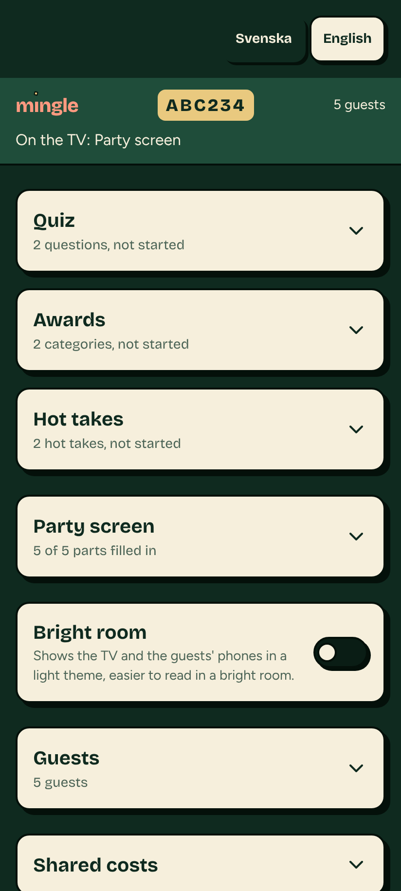
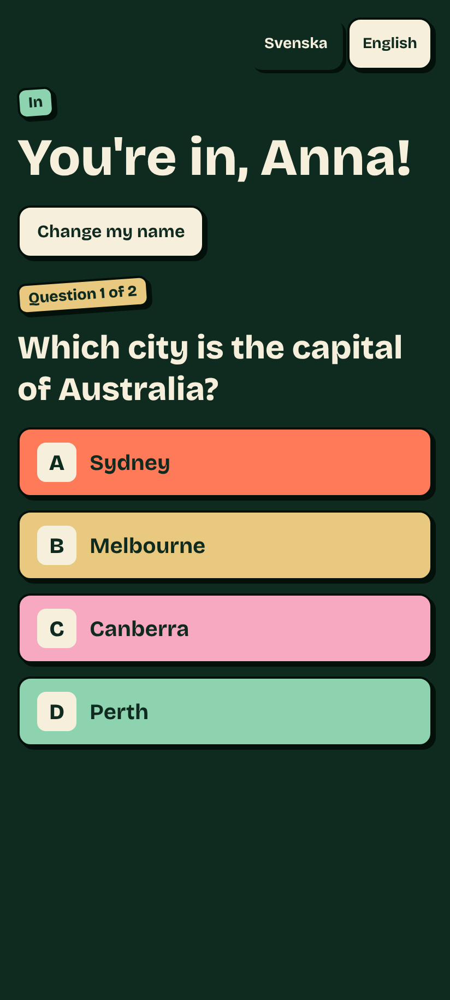
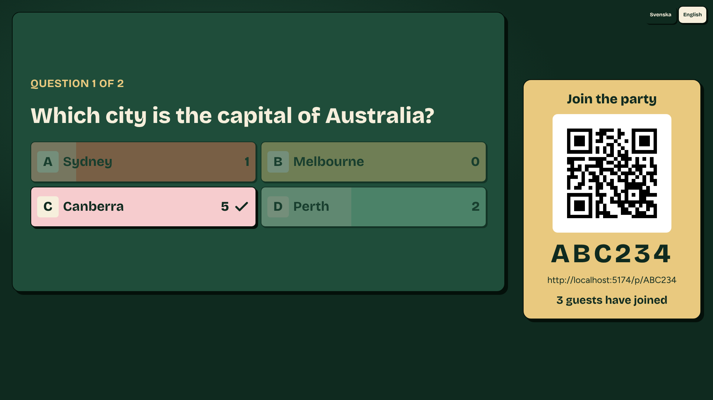

# Mingle

**Run an interactive party evening on your TV in a few minutes.**


Mingle is a web app for hosting an afterwork, a team event or a bachelor/bachelorette party. You set up the evening on your phone, open the TV link in a browser on the TV or a laptop, and your guests join by scanning the QR code on the screen. Nobody needs to install anything or create an account.

## What it does

### The party screen

The TV is useful from the moment it is switched on, even if you never start an activity. It rotates calmly between your welcome message, the join QR code, a QR code for the wifi, a QR code for the music (paste a Spotify Jam or shared playlist link), the menu, the evening's schedule and the guests who have joined.

### Activities, if you want them

- **Quiz**: multiple-choice questions. Guests answer on their phones, the TV shows how everyone voted and the right answer, and there is a scoreboard at the end.
- **Awards**: "Most likely to…" categories. Guests vote on each other, and the TV reveals the winners one by one.
- **Hot takes**: statements to agree or disagree with. The TV shows how the room split.

Each activity comes with ready-made content for the type of party you picked, in Swedish and English. You can use it as it is, remove what doesn't fit, add your own, or switch an activity off completely. Mingle works fully without AI: all content is either built in or written by you.

### Running the evening

You get a private host link that works as your remote control. From your phone you start and stop activities, go to the next question, reveal results, see who has joined and remove a guest if needed. A **bright room** switch gives the TV and the guests' phones a light theme when the room is sunny.

### Shared costs (optional)

If you paid for food or drinks, you can list what you bought and who shares each item. Guests see nothing until you press **Send the bill**. Then each guest gets a small receipt icon on their phone with their share and a Swish button, can tell you they have paid, and you confirm it. Mingle never moves any money itself, and the bill is never shown on the TV.

### Privacy

Guests only give a display name. No emails, phone numbers or other personal data are stored. Every event and everything in it is deleted automatically 30 days after it was created.

## Screenshots

<table>
  <tr>
    <th>Host (phone)</th>
    <th>Guest (phone)</th>
  </tr>
  <tr>
    <td width="50%"></td>
    <td width="50%"></td>
  </tr>
</table>

**TV during a quiz**: the answers come in from the phones and the right one is revealed.



The screenshots use example data in the afterwork theme. Each type of party has its own look.

---

## For developers

Everything below is about building and running Mingle yourself.

### Tech stack

| Area | Choice |
|---|---|
| Frontend | Vite, React, TypeScript (strict), React Router |
| Styling | Tailwind CSS v4 and shadcn/ui, themed through CSS variables in `src/app/theme.css` |
| Backend | Supabase: Postgres with Row Level Security, Realtime, and one Edge Function (`host-actions`) |
| Guest identity | Supabase anonymous sign-in, so every guest has an `auth.uid()` without an account |
| Validation | Zod |
| Languages | react-i18next, Swedish and English |
| Hosting | Vercel (frontend) and Supabase (backend), on free plans |
| Tests | Vitest (unit and database), Playwright (key flows, with Supabase faked) |

### How it fits together

- **The database is the source of truth.** The event's state lives in Postgres. The TV and the guests' phones subscribe through Realtime and render it.
- **Only the host changes the flow of the evening.** Every host action goes through the `host-actions` Edge Function, which checks the secret key from the host link (stored hashed). The key sits in the URL fragment (`#key=…`), so it never reaches a server log.
- **Security lives in the database.** Guests can only write their own answers and votes, enforced by RLS, so nothing changes if someone calls Supabase from devtools.
- **All Supabase calls are in `src/api/`.** Components never use the Supabase client directly.
- **Niches are data.** Each party type is a config file in `src/niches/` with its theme, default activities and built-in content.
- **Activities are self-contained.** Each one in `src/modules/<name>/` has its own host, TV and guest parts.
- **Nightly cleanup.** A pg_cron job in the database deletes expired events; every table that belongs to an event cascades from it.

| Route | Who | Purpose |
|---|---|---|
| `/` | Everyone | Landing page |
| `/new` | Host | Setup wizard |
| `/host/:code#key=…` | Host | Control panel |
| `/tv/:code` | TV | The big screen |
| `/p/:code` | Guests | Join and play |
| `/p/:code/summary` | Everyone | Summary after the event (a placeholder page for now) |

One app serves every event. Events are rows in the database, identified by a short code.

### Run it locally

You need Node 24 (see `.nvmrc`) and npm.

```bash
npm ci
cp .env.example .env
npm run dev
```

Then open http://localhost:5173. The app starts without filling in `.env`. To create and run real events locally, start the local Supabase stack (needs Docker) and put its URL and publishable key in `.env`:

```bash
npm run db:start
```

[docs/supabase.md](docs/supabase.md) explains the local stack, Docker on Windows and the nightly cleanup.

### Checks

| Command | What it runs |
|---|---|
| `npm run typecheck` | TypeScript for the app |
| `npm run typecheck:functions` | TypeScript for the Edge Functions |
| `npm run lint` | ESLint |
| `npm run format:check` | Prettier |
| `npm test` | Unit tests and the design-rule check |
| `npm run test:db` | Database and RLS tests against the local stack |
| `npm run test:e2e` | Playwright flows, with Supabase faked |

Pull requests run these on GitHub as well.

### Learn more

- [CLAUDE.md](CLAUDE.md): scope, architecture principles, folder structure and working rules
- [docs/](docs/README.md): decisions, workflow, Supabase and hosting guides, design and glossary
- [docs/hosting.md](docs/hosting.md): how Mingle is deployed, and the launch checklist
