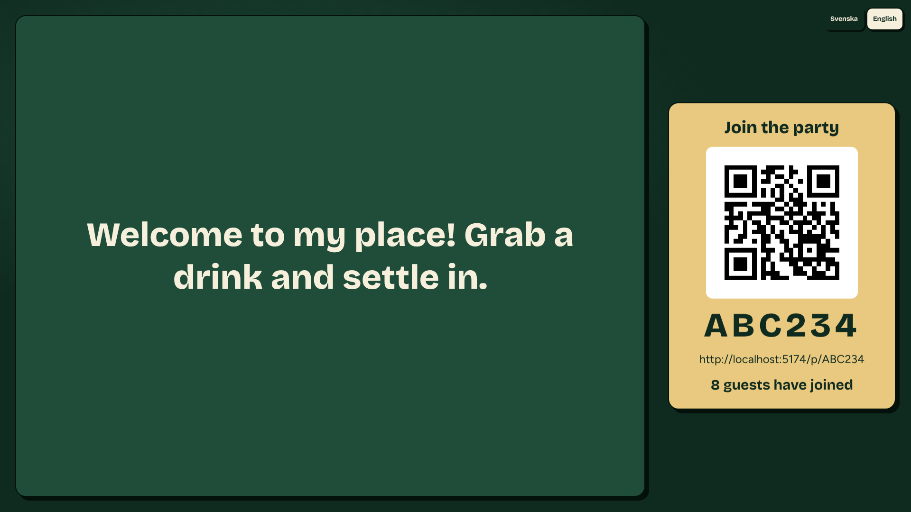

# Mingle



Set up an interactive party evening in a few minutes. A host picks a niche (afterwork, team event, bachelor/bachelorette party) and gets ready-made activities, guests join from their phones by scanning a QR code on the TV, and results show up live on the big screen.

## What you get

- **Party screen**: the TV rotates between welcome message, join QR code, music and wifi, menu, schedule and who has joined, even if no activity is running.
- **Quiz, Awards and Hot takes**: optional activities with built-in content per niche in Swedish and English. The host can add their own or switch any off.
- **Guests need no account**: they join with a code or QR and pick a display name.
- **Optional AI suggestions (planned)**: not built yet. Once they are, nothing will be shown to guests or on the TV until the host approves it.

## Run it

You need Node 24 (see `.nvmrc`) and npm.

```bash
npm ci
cp .env.example .env
npm run dev
```

Then open http://localhost:5173. The app also starts without filling in `.env`.

## Learn more

- [CLAUDE.md](CLAUDE.md): scope, architecture principles, folder structure and working rules
- [docs/](docs/README.md): decisions, workflow, Supabase and hosting guides, design, and an archive of old plans

## Privacy

Guests are identified by a display name only. No emails, phone numbers or other personal data are stored, and event data is meant to be deleted after a fixed retention period (30 days). Automatic deletion is planned and not built yet.
