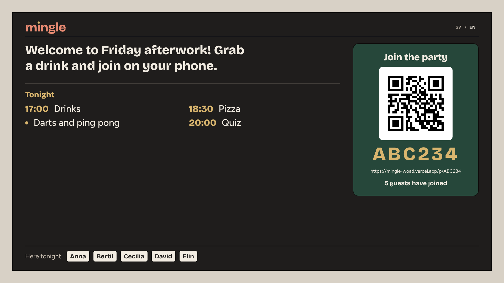
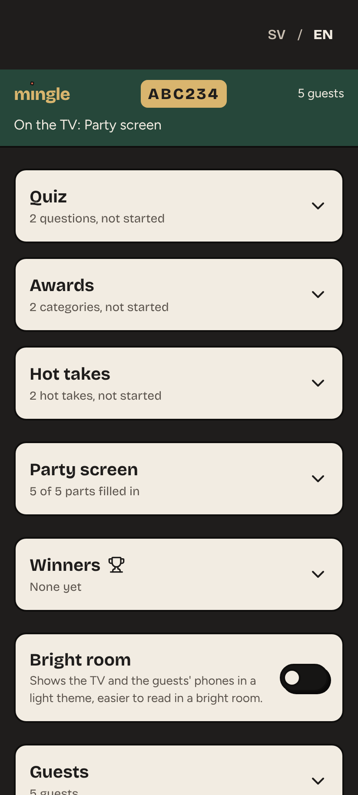
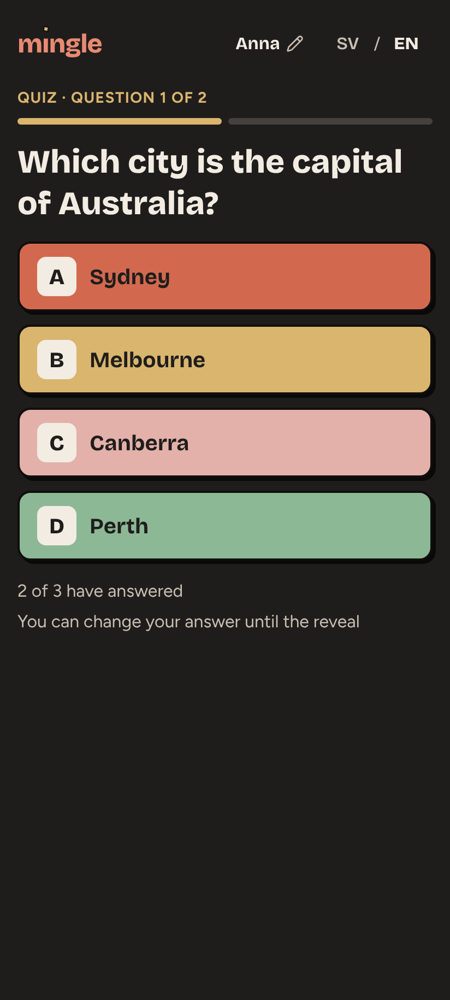
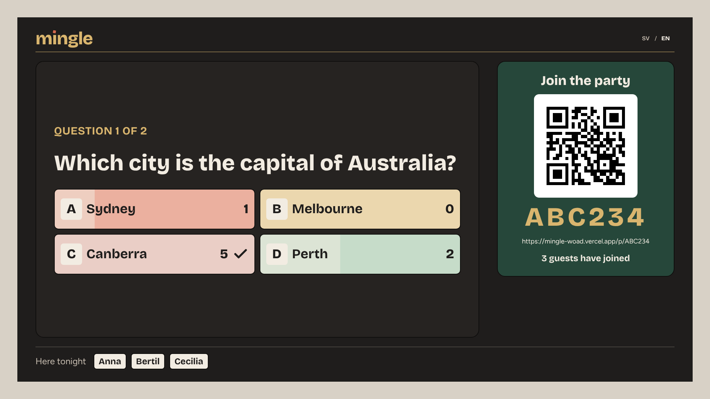

# Mingle

Mingle låter dig sätta upp en interaktiv festkväll på några minuter: gästerna går med från sina telefoner och resultaten visas live på TV:n. Det löser problemet att den som är värd för en afterwork, ett teamevent eller en svensexa annars bygger underhållningen från noll, med frågor i ett dokument, omröstningar genom handuppräckning och en tom TV.

**Live:** https://mingle-woad.vercel.app



## Vad det gör

Värden skapar ett event på sin telefon, väljer typ av fest (afterwork, teamevent eller svensexa/möhippa) och får färdigt innehåll på svenska eller engelska. TV:n öppnas i en webbläsare och visar en QR-kod som gästerna skannar för att gå med, utan app och utan konto, bara med ett visningsnamn.

- **Partyskärmen** visar sig själv utan att värden gör något: välkomstmeddelande, QR-kod för att gå med, wifi, musik (länk till Spotify Jam eller en delad spellista), meny, kvällens program och vilka gäster som har gått med.
- **Aktiviteter** är valfria och kan stängas av en och en: **Quiz** (flervalsfrågor med poängtavla), **Awards** ("Mest sannolikt att…" där gästerna röstar på varandra), **Hot takes** (håller med eller inte), **Tävlingar** (pingis, dart och liknande där gästerna rapporterar matcher och en tabell uppdateras live) och **Lyckohjulet** (värden snurrar ett hjul på TV:n som drar en gäst, en utmaning eller ett pris).
- **Värdpanelen** är en privat länk med två vyer. **Run** är fjärrkontrollen: se vad TV:n visar, starta nästa aktivitet, gå till nästa fråga, visa resultat och skicka ett kort meddelande till gästerna. **Prepare** är allt värden ändrar: innehållet i varje aktivitet, partyskärmen, program, delade kostnader, gäster, länkar och ett ljust läge för soliga rum.
- **Delade kostnader** (valfritt): värden listar vad som köpts och vem som delar på vad. Gästerna ser först något när värden skickar räkningen, och får då sin del med en Swish-knapp. Mingle flyttar aldrig pengar själv.
- **Sammanfattning** efter kvällen på `/p/:code/summary` (visar i dag resultaten från tävlingarna).
- **Språk:** gränssnittet finns på svenska och engelska, och alla kan byta språk på sin enhet.

Allt innehåll kommer från appen eller värden själv. Mingle fungerar fullt ut utan AI.

### Skärmbilder

<table>
  <tr>
    <th>Värd (telefon)</th>
    <th>Gäst (telefon)</th>
  </tr>
  <tr>
    <td width="50%"></td>
    <td width="50%"></td>
  </tr>
</table>

**TV under en quiz:** svaren kommer in från telefonerna och rätt svar avslöjas.



Skärmbilderna använder exempeldata.

## Kom igång

### Krav

- Node 24 (se `.nvmrc`) och npm
- Docker, bara om du vill köra Supabase lokalt (för att skapa och köra riktiga events)
- Ett Supabase-projekt om du vill köra mot ett hostat (URL och publishable key)

### Installation

```bash
git clone https://github.com/samroncode/mingle
cd mingle
npm ci
```

### Konfiguration

Kopiera mallen och fyll i värdena:

```bash
cp .env.example .env
```

```
VITE_SUPABASE_URL=din-supabase-url
VITE_SUPABASE_PUBLISHABLE_KEY=din-publishable-key
```

Alla variabler finns förklarade i `.env.example`. Appen startar även utan ifyllda värden, men då går det inte att skapa events. Hemliga nycklar för Edge Functions får aldrig ha prefixet `VITE_` och hör hemma i `supabase/functions/.env`.

### Kör projektet

```bash
npm run db:start   # startar lokala Supabase (kräver Docker), kopiera URL och nyckel till .env
npm run dev        # öppna http://localhost:5173
```

Mer om den lokala stacken: [docs/supabase.md](docs/supabase.md).

### Kontroller

| Kommando | Vad det kör |
|---|---|
| `npm run typecheck` | TypeScript för appen |
| `npm run typecheck:functions` | TypeScript för Edge Functions |
| `npm run lint` | ESLint |
| `npm run format:check` | Prettier |
| `npm test` | Enhetstester och designregler |
| `npm run test:db` | Databas- och RLS-tester mot lokala stacken |
| `npm run test:e2e` | Playwright-flöden, med Supabase fejkat |

Pull requests kör samma kontroller på GitHub.

## Arkitektur

Databasen är källan till sanningen. Eventets tillstånd ligger i Postgres, och TV:n och gästernas telefoner prenumererar via Realtime och ritar upp det. Bara värden ändrar kvällens flöde, och varje värdåtgärd går genom Edge Function `host-actions`, som kontrollerar den hemliga nyckeln från värdlänken (lagrad hashad, och placerad efter `#` i URL:en så att den aldrig når en serverlogg). Gäster kan bara skriva sina egna svar och röster, vilket Row Level Security i databasen garanterar även om någon anropar Supabase direkt. All Supabase-åtkomst ligger i `src/api/`. Fester och aktiviteter är data respektive självständiga moduler, och ett nattligt pg_cron-jobb raderar events 30 dagar efter att de skapats.

```
mingle/
├── src/
│   ├── api/          # all Supabase-åtkomst (frågor, ändringar, realtime)
│   ├── app/          # appskal, router, tema (theme.css)
│   ├── modules/      # quiz, awards, hottakes, competitions, wheel (host, TV, gäst)
│   ├── niches/       # festtyper: tema, standardaktiviteter, färdigt innehåll
│   ├── partyscreen/  # TV:ns viloläge
│   ├── views/        # sidor per route (skapa, värd, TV, gäst, sammanfattning)
│   ├── i18n/         # sv.json, en.json
│   └── lib/          # hjälpfunktioner och Zod-scheman
├── supabase/
│   ├── migrations/   # databasschema och RLS-policyer
│   ├── functions/    # Edge Function host-actions
│   └── tests/        # databastester mot lokala stacken
├── e2e/              # Playwright-tester
└── docs/             # beslut, hosting, design, ordlista
```

| Route | Vem | Vad |
|---|---|---|
| `/` | Alla | Startsida |
| `/new` | Värd | Guide för att skapa event |
| `/host/:code#key=…` | Värd | Kontrollpanel |
| `/tv/:code` | TV | Storbildsskärmen |
| `/p/:code` | Gäster | Gå med och spela |
| `/p/:code/summary` | Alla | Sammanfattning efter kvällen |

## Teknisk stack

| Komponent | Val | Anledning |
|---|---|---|
| Frontend | Vite, React, TypeScript (strict) | Snabbt, välkänt och bra stöd i verktyg |
| Routing | React Router | Varje vy är en route |
| Styling | Tailwind CSS v4, shadcn/ui | Konsekventa komponenter, tema via CSS-variabler |
| Backend | Supabase (Postgres, Realtime, Edge Functions) | Realtid mellan TV, värd och gäster utan egen server |
| Gästidentitet | Supabase anonym inloggning | Varje gäst får ett `auth.uid()` för RLS utan konto |
| Validering | Zod | Delade scheman för formulär och API |
| Språk | react-i18next | Svenska och engelska |
| Hosting | Vercel och Supabase | Gratisplaner och enkla deployer |
| Tester | Vitest, Playwright | Enhets-, databas- och flödestester |

## Begränsningar

- **Ingen AI-hjälp i dag.** AI-förslag på innehåll finns planerade som ett tillval men är inte byggda. Allt färdigt innehåll är skrivet i förväg.
- **Ingen musikintegration.** Musik är bara en länk som visas som QR-kod, utan Spotify-API.
- **Inga konton.** Den som tappar värdlänken kan inte ta tillbaka kontrollen över eventet.
- **Eventen försvinner.** Allt raderas automatiskt efter 30 dagar.
- **Sammanfattningen är kort.** Den visar i dag bara tävlingarnas resultat, inte Quiz, Awards eller Hot takes.
- **Alla festtyper ser likadana ut** (samma "lounge"-tema) tills vidare.
- **Delade kostnader** använder Swish och passar därför bara svenska användare.
- **Kräver internet** hos TV, värd och gäster, eftersom allt synkas via Supabase.

## Utvecklat med

Claude Code (agentdriven utveckling) som del av kursen Next-Generation Software Development with AI.

## Läs mer

- [CLAUDE.md](CLAUDE.md): omfattning, arkitekturprinciper och arbetsregler
- [docs/](docs/README.md): beslut, arbetssätt, Supabase, design och ordlista
- [docs/hosting.md](docs/hosting.md): hur Mingle driftsätts, och checklistan för lansering
- [docs/logging.md](docs/logging.md): felloggar och hur man läser dem

## CV-punkt

Designade och utvecklade Mingle, en webbapp i React, TypeScript, Tailwind och Supabase (Postgres med Row Level Security, Realtime, Edge Functions), med hjälp av agentdriven utveckling (Claude Code). Projektet låter en värd köra en interaktiv festkväll med quiz, omröstningar, tävlingar och lyckohjul på TV:n, och är tillgängligt på https://mingle-woad.vercel.app (kod: github.com/samroncode/mingle).
